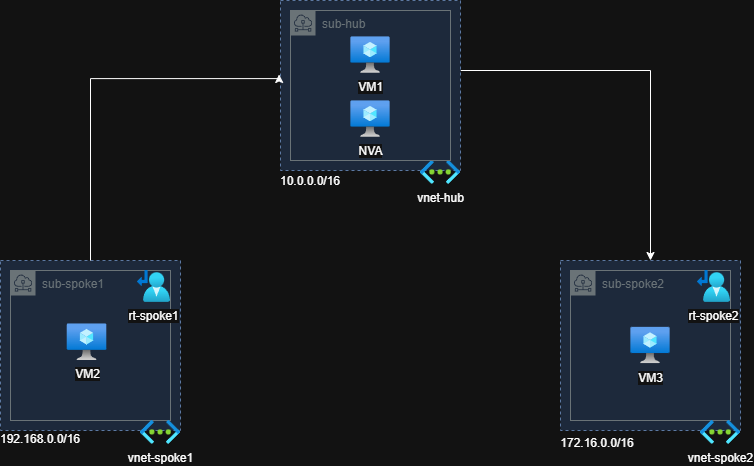

# Azure Hub-Spoke Network with Linux NVA

## Overview

This project demonstrates the implementation of a **Hub-Spoke network topology in Microsoft Azure**, using an Ubuntu Linux virtual machine as a **Network Virtual Appliance (NVA)** to route traffic between two isolated spoke virtual networks.

The main goal of this lab is to explore Azure networking concepts such as:

- Hub-Spoke network architecture
- Azure Virtual Networks (VNets)
- VNet Peering
- Network Virtual Appliance (NVA)
- User Defined Routes (UDRs)
- Azure Route Tables
- Linux IP Forwarding
- Network Security Groups (NSGs)
- Inter-spoke routing
- Azure Network Watcher

The environment was built as a hands-on Azure networking lab.


## Architecture

The environment consists of one Hub VNet and two Spoke VNets.



The Hub VNet provides centralized routing between the Spoke VNets. Traffic between Spoke 1 and Spoke 2 is forwarded through the NVA located in the Hub.


## Network Design

### Hub

**VNet:** `vnet-hub`
**Address Space:** `10.0.0.0/16`

Resources:

- `VM1` - `10.0.0.4`
- `NVA` - `10.0.0.5`

The NVA is an Ubuntu Linux virtual machine configured to forward network traffic between the spoke networks.

### Spoke 1

**VNet:** `vnet-spoke1`  
**Address Space:** `192.168.0.0/16`

Resources:

- `VM2` - `192.168.0.4`
- Route Table: `rt-spoke1`

### Spoke 2

**VNet:** `vnet-spoke2`  
**Address Space:** `172.16.0.0/16`

Resources:

- `VM3` - `172.16.0.4`
- Route Table: `rt-spoke2`

All virtual machines used in this lab run Ubuntu Linux.


## VNet Peering

The Hub VNet is peered with both Spoke VNets:

```text
vnet-hub <--> vnet-spoke1
vnet-hub <--> vnet-spoke2
```

There is no direct peering between `vnet-spoke1` and `vnet-spoke2`.

Because the spoke networks are not directly connected, inter-spoke traffic is routed through the NVA in the Hub.

Forwarded traffic is allowed on the VNet peerings so that traffic forwarded by the NVA can traverse the peering connections.


## Routing

User Defined Routes (UDRs) are used to direct inter-spoke traffic through the NVA.

### Spoke 1 Route

Traffic destined for Spoke 2 is sent to the NVA:

```text
Destination: 172.16.0.0/16
Next Hop Type: Virtual Appliance
Next Hop IP: 10.0.0.5
```

Traffic flow:

```text
VM2
192.168.0.4
    │
    ▼
rt-spoke1
    │
    ▼
NVA
10.0.0.5
    │
    ▼
VM3
172.16.0.4
```

### Spoke 2 Route

Traffic destined for Spoke 1 follows the reverse path:

```text
Destination: 192.168.0.0/16
Next Hop Type: Virtual Appliance
Next Hop IP: 10.0.0.5
```

Traffic flow:

```text
VM3
172.16.0.4
    │
    ▼
rt-spoke2
    │
    ▼
NVA
10.0.0.5
    │
    ▼
VM2
192.168.0.4
```

This creates symmetric routing between the two spoke networks through the Hub NVA.


## Linux NVA Configuration

The NVA uses Ubuntu Linux and acts as a software router between the spoke networks.

IP forwarding must be enabled both on the Azure Network Interface and inside the Linux operating system.

### Verify IP Forwarding

```bash
sysctl net.ipv4.ip_forward
```

Expected result:

```text
net.ipv4.ip_forward = 1
```

### Enable IP Forwarding

```bash
sudo sysctl -w net.ipv4.ip_forward=1
```

For persistent configuration:

```bash
echo 'net.ipv4.ip_forward=1' | sudo tee /etc/sysctl.d/99-nva.conf
```

Apply the configuration:

```bash
sudo sysctl --system
```

The Azure NIC attached to the NVA must also have **IP Forwarding enabled**.


## Traffic Flow

Example communication from VM2 to VM3:

```text
VM2 (192.168.0.4)
        │
        │ Destination: 172.16.0.4
        ▼
Spoke 1 Route Table
        │
        │ Next Hop: 10.0.0.5
        ▼
NVA (10.0.0.5)
        │
        │ Linux IP Forwarding
        ▼
Hub → Spoke 2 Peering
        │
        ▼
VM3 (172.16.0.4)
```

The return traffic follows the reverse path through the NVA.


## Validation

Connectivity was validated in both directions.

From VM2:

```bash
ping 172.16.0.4
```

From VM3:

```bash
ping 192.168.0.4
```


## Troubleshooting

Useful commands used during the lab:

### Check Linux interfaces

```bash
ip addr
```

### Check local routing table

```bash
ip route
```

### Check IP forwarding

```bash
sysctl net.ipv4.ip_forward
```

Azure **Network Watcher - Next Hop** can also be used to validate the Azure routing path.

For traffic originating from VM2 and destined for VM3, the expected next hop is:

```text
Next Hop Type: Virtual Appliance
Next Hop IP: 10.0.0.5
```


## Key Concepts Learned

This lab helped reinforce several important Azure networking concepts:

### VNet Peering

VNet Peering provides connectivity between Azure virtual networks. In this architecture, each Spoke VNet is connected to the Hub VNet.

### Hub-Spoke Architecture

The Hub centralizes shared networking components while workloads remain isolated in separate Spoke VNets.

### Network Virtual Appliance

An Ubuntu Linux VM is used as an NVA to route traffic between the Spoke VNets.

### User Defined Routes

Azure Route Tables override the normal routing path for inter-spoke traffic and direct packets to the NVA.

### IP Forwarding

For a Linux VM to function as a router, packet forwarding must be enabled in both Azure and the Linux operating system.

### Traffic Inspection

Tools such as Azure Network Watcher make it possible to validate the effective path taken by network traffic.

## Repository Structure

```text
azure-hub-spoke-nva-lab/
│
├── README.md
├── .gitignore
│
├── docs/
│   └── azure-hub-spoke-network-architecture.drawio.png
│
└── infra/
    └── main.bicep
```

## Security Considerations

This repository is intended for educational purposes.

Sensitive information should never be committed to the repository, including:

- SSH private keys
- Passwords
- Azure credentials
- Service principal secrets
- Access tokens
- Private `.env` files

The Linux NVA used in this project is intended to demonstrate routing concepts and should not be considered a production firewall or production-ready NVA implementation.


## Lessons Learned

Building this lab provided practical experience with Azure routing behavior in a Hub-Spoke topology.

One of the key lessons was understanding that connecting each Spoke VNet to the Hub does not by itself provide the desired inter-spoke routing path. User Defined Routes and a routing device in the Hub are used to control the traffic flow between the networks.

The lab also demonstrated the relationship between Azure networking configuration and Linux networking configuration. For the Ubuntu NVA to successfully forward traffic, IP forwarding needs to be configured at both the Azure NIC and operating system levels.

Finally, tools such as Azure Network Watcher, Linux routing commands, ping, and tcpdump were useful for validating and troubleshooting the complete packet path between the Spoke VNets.


## Disclaimer

This project was created for educational and hands-on learning purposes. The architecture is intentionally simplified and is not intended to represent a production-ready Azure network design.
